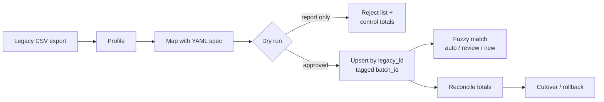

# Migration Toolkit

[](https://github.com/Itsraza099/migration-toolkit/actions/workflows/ci.yml)

A toolkit for moving customer records out of a legacy CRM safely: profile the source,
map it with a reviewable spec, dry-run, upsert, de-duplicate with fuzzy matching, and
reconcile control totals before cutover.

> **Status:** scaffolded. Profiling, mapping specs, dry runs, fuzzy matching and
> reconciliation work on CSV; the Postgres upsert, batch rollback and bank-detail checks are next.

## Pipeline



## Try it

```bash
make install
uv run migrate profile samples/legacy_customers.csv
uv run migrate dry-run mappings/customers.yaml samples/legacy_customers.csv --sum "Annual Value"
```

## Break it on purpose

- [ ] Run the same load twice → row count unchanged (upsert, not insert)
- [ ] Delete a row from the target → reconciliation reports the gap
- [ ] Add "Acme Widgets Limited" → lands in the review band, not auto-merged
- [ ] Roll back a batch → target returns to its pre-load state

## Learning notes

- [Decision records](docs/decisions/) · [Glossary](docs/glossary.md) · [Interview check](docs/interview-check.md)
- Cutover runbook and rollback plan: `docs/runbook.md` (to write)
