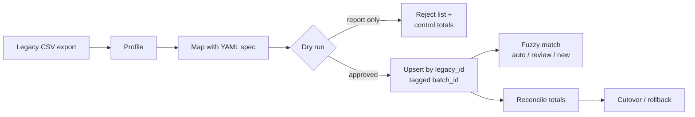

# Migration Toolkit

**Move customer data out of a legacy CRM without losing, duplicating or corrupting a record,
and prove it.** Profile, map, dry-run, upsert, de-duplicate and reconcile, with a rollback plan.

[](https://github.com/Itsraza099/migration-toolkit/actions/workflows/ci.yml)


| | |
|---|---|
| **Problem** | Migrations fail quietly: rows go missing, the same company appears three times, and there's no way back. |
| **Solution** | A config-driven pipeline where every run can be a dry run, every load can be re-run safely, and totals are reconciled before cutover. |
| **Shows** | Data profiling, source-to-target mapping, dry runs, upserts, fuzzy matching with confidence scores, control totals, cutover and rollback |
| **Stack** | Python · Typer · Pydantic · rapidfuzz · Postgres |

## What a dry run looks like

```text
$ migrate dry-run mappings/customers.yaml samples/legacy_customers.csv --sum "Annual Value"
DRY RUN — customer → public.customers (nothing written)
  source rows: 5
  would load:  4
  rejected:    1
  control total Annual Value: 5850.50
    line 5: customer: required field 'Company Name' is blank
```

## Pipeline



## Engineering highlights

- **Mappings are data, not code.** A [YAML spec](mappings/customers.yaml) a business analyst
  can review says which source column becomes which target column.
- **Duplicates are scored, not guessed.** "Acme Widgets Ltd" vs "ACME widgets ltd" links
  automatically; "Acme Widgets Limited" goes to a person for review; anything below 75 is new.
  ([matching.py](src/migration_toolkit/matching.py))
- **Nothing lost in transit.** Row counts and money totals are taken on both sides and
  reconciled; any difference is reported line by line.
- **Re-runnable and reversible** *(in progress)*. Loads upsert on the legacy id and tag a batch id, so a
  re-run updates instead of duplicating, and a batch can be rolled back.
- Reasoning and rejected alternatives: [decision 0001](docs/decisions/0001-config-driven-migration.md).

## Proving it's correct

| Break it on purpose | What catches it | Status |
|---|---|---|
| Run the same load twice | Row count unchanged (upsert, not insert) | planned |
| Lose a row between source and target | Reconciliation reports the gap | ✅ tested |
| Add "Acme Widgets Limited" | Lands in the review band, not auto-merged | ✅ tested |
| Roll back a batch | Target returns to its pre-load state | planned |

## Build progress

- [x] Profiling, YAML mapping specs, dry-run CLI
- [x] Fuzzy matching with confidence bands
- [x] Control totals and reconciliation
- [ ] Postgres upsert with batch ids and rollback
- [ ] Bank-detail checks with [ukbankcheck](https://github.com/Itsraza099/ukbankcheck)
- [ ] Cutover runbook and rollback plan

## How I worked

Each choice has a [decision record](docs/decisions/); the [glossary](docs/glossary.md) is my
own explanation of each concept. See all projects on [my profile](https://github.com/Itsraza099).

<details>
<summary><b>Run locally</b></summary>

Needs [uv](https://docs.astral.sh/uv/).

```bash
make install
uv run migrate profile samples/legacy_customers.csv
uv run migrate dry-run mappings/customers.yaml samples/legacy_customers.csv --sum "Annual Value"
make check
```
</details>
